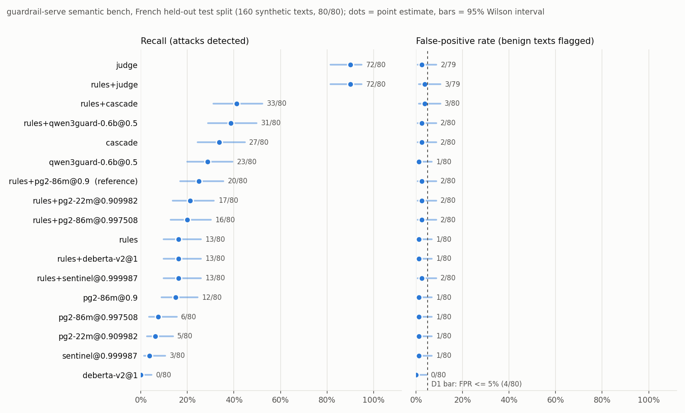

# Semantic sidecar and judge evaluation

Two measurements, reported apart:

- **L12b (current)**: the frozen-protocol bench of [ADR 0023](../../docs/adr/0023-semantic-model-bench.md)
  on the held-out French test split of [ADR 0022](../../docs/adr/0022-semantic-bench-corpus.md),
  with the historical corpora measured again as diagnostics.
- **L11 (history)**: the earlier fixed-threshold measurement, kept unchanged below. Its
  figures are diagnostics on corpora that informed the rules, not held-out results.

Built with Llama.

## L12b: frozen-protocol bench (14/11/2026)

**Verdict.**

- On the held-out French test split (160 synthetic texts, 80 attacks, 80 hard benign
  texts), the current chain, rules + Prompt Guard 2 86M at `0.9`, finds **20/80**
  attacks (25.0%) for **2/80** false positives (2.5%). The rules alone find 13/80.
- The **System One judge** (`jev-1.14.0`, question `noul`, threshold 0.7, all fixed
  before measurement) finds **72/80** (90.0%, 95% CI 81.5 to 94.8) for **2/79** false
  positives alone and **3/79** with the rules, plus one request refused before egress
  (an unmasked demonstration card number). p50 133 ms end to end, USD 0.019 per 1000
  requests at the published price.
- The **cascade** rules -> 86M -> judge in the frozen gray zone sends 25/160 texts to
  the judge and finds 33/80 with the rules (41.2%), 3/80 false positives, USD 0.003 per
  1000 requests. It is held back by the gate, not by the judge: the 86M model scores
  53 of the 80 test attacks below the zone's lower bound (0.0155), so they never
  reach the judge.
- Among local models, only **Qwen3Guard-Gen-0.6B** improves recall: 31/80 with the
  rules (38.8%) for 2/80 false positives, but at p50 2.9 s per request on 2 vCPUs.
  Recalibrated 86M (threshold 0.9975), 22M, ProtectAI DeBERTa v2 and Qualifire Sentinel
  find no more than the current chain once their threshold keeps calibration false
  positives within budget (16 to 17 of 80 with the rules).
- Decision rule D1 (frozen before the test run): **rules + judge**, **rules +
  cascade** and **rules + Qwen3Guard** pass (test FPR at most 4/80 counting errors on
  benign texts as false positives, recall at least 20/80). Rules + judge passes at the
  bound: 3 false positives plus 1 errored benign text = 4/80. What this changes and
  what it does not is in the [recommendation](#recommendation).

### Protocol

Frozen in [`bench/results/protocol.json`](bench/results/protocol.json) (sha256
`46076199654a…79fb3f`), committed before the first test run. The report refuses any
run measured under another protocol, on another corpus version, with missing,
repeated or relabelled cases, or with another threshold, zone or judge setting.

| Step | Rule |
| --- | --- |
| Calibration | `bench-calibration` split only (80 texts, 40/40). Local models and rules only; the judge never sees it |
| R1 threshold | per local classifier, the lowest candidate (distinct calibration scores and 1.0) keeping rules ∪ model calibration false positives at most floor(5% × 40) = 2, inclusive `>=` |
| Qwen3Guard | no free parameter: prompt moderation, greedy decoding, strict parse; injection iff the categories contain `Jailbreak` (score 1.0 or 0.0, threshold 0.5). `Unsafe` with other categories is not an injection |
| R2 gray zone | upper bound U = the 86M R1 threshold, lower bound L = the lowest calibration score keeping at most 25% of calibration texts (20) in [L, U], both inclusive |
| Judge | fixed a priori: `jev-1.14.0`, `noul`, threshold 0.7, timeout 10 s, fail closed, test split only |
| D1 | a chain may replace the default (semantic `annotate`, 86M) only if its test FPR is at most 5% (4/80) and its test recall is at least the recall of rules + 86M at 0.9; errors count against the candidate |
| Test | `bench-test` (160 texts, 80/80), each candidate once, after the freeze; the historical corpora (`french-injection-v1`, `original-v1`) measured with the same frozen settings, reported apart, never used for tuning |

Calibration outcome:

| Model | Threshold | Rule | Rules + model, calibration TP / FP (of 40 / 40) | Model alone TP / FP |
| --- | ---: | --- | ---: | ---: |
| Prompt Guard 2 86M | 0.997508 | R1 | 10 / 2 | 3 / 1 |
| Prompt Guard 2 22M | 0.909982 | R1 | 11 / 2 | 5 / 1 |
| ProtectAI DeBERTa v2 | 1.0 | R1 | 8 / 1 | 0 / 0 |
| Qualifire Sentinel | 0.999987 | R1 | 8 / 2 | 3 / 1 |
| Qwen3Guard-Gen-0.6B | 0.5 | binary label | 18 / 2 | 14 / 1 |
| Rules alone | | | 8 / 1 | |

Gray zone: [0.015489, 0.997508], 20/80 calibration texts inside. DeBERTa and Sentinel
give scores of 1.0 or nearly 1.0 to benign calibration texts, so R1 pushes their
threshold to the top of the scale and they keep almost no recall.

### Results on the held-out test split (`bench-test`, French, 80 attacks / 80 benign)

Detection = the configuration's finding (chains: the request is blocked). Errors are
apart and never counted as detections. McNemar: exact two-sided test against the
reference on paired cases, "a/b" = cases only this configuration gets right / only the
reference gets right.

| Configuration | TP | FP | TN | FN | Errors | Recall (95% CI) | FPR (95% CI) | e2e p50 / p95 ms | Judge share | USD / 1000 req | McNemar p (a/b) | D1 |
| --- | ---: | ---: | ---: | ---: | ---: | --- | --- | --- | ---: | ---: | --- | --- |
| rules | 13 | 1 | 79 | 67 | 0 | 16.2% [9.7, 25.8] | 1.2% [0.2, 6.7] | 1 / 1 | | | 0.070 (1/7) | |
| **rules + 86M @ 0.9 (reference)** | 20 | 2 | 78 | 60 | 0 | 25.0% [16.8, 35.5] | 2.5% [0.7, 8.7] | 205 / 253 (replay) | | | | |
| rules + 86M @ 0.997508 | 16 | 2 | 78 | 64 | 0 | 20.0% [12.7, 30.0] | 2.5% [0.7, 8.7] | 204 / 253 | | | 0.125 (0/4) | fail |
| rules + 22M @ 0.909982 | 17 | 2 | 78 | 63 | 0 | 21.2% [13.7, 31.4] | 2.5% [0.7, 8.7] | 96 / 120 | | | 0.549 (4/7) | fail |
| rules + DeBERTa v2 @ 1.0 | 13 | 1 | 79 | 67 | 0 | 16.2% [9.7, 25.8] | 1.2% [0.2, 6.7] | 232 / 312 | | | 0.070 (1/7) | fail |
| rules + Sentinel @ 0.999987 | 13 | 2 | 78 | 67 | 0 | 16.2% [9.7, 25.8] | 2.5% [0.7, 8.7] | 340 / 484 | | | 0.039 (1/8) | fail |
| rules + Qwen3Guard-Gen-0.6B | 31 | 2 | 78 | 49 | 0 | 38.8% [28.8, 49.7] | 2.5% [0.7, 8.7] | 2888 / 3551 | | | 0.007 (13/2) | pass |
| rules + judge | 72 | 3 | 76 | 8 | 1 | 90.0% [81.5, 94.8] | 3.8% [1.3, 10.6] of 79 | 133 / 172 | 160/160 | 0.019 | <0.001 (53/2) | pass |
| rules + cascade | 33 | 3 | 77 | 47 | 0 | 41.2% [31.1, 52.2] | 3.8% [1.3, 10.5] | 208 / 379 (replay) | 25/160 | 0.0030 | 0.002 (13/1) | pass |

Each component alone (same runs):

| Component | TP | FP | TN | FN | Errors | Recall (95% CI) | FPR (95% CI) |
| --- | ---: | ---: | ---: | ---: | ---: | --- | --- |
| 86M @ 0.9 | 12 | 1 | 79 | 68 | 0 | 15.0% [8.8, 24.4] | 1.2% [0.2, 6.7] |
| 86M @ 0.997508 | 6 | 1 | 79 | 74 | 0 | 7.5% [3.5, 15.4] | 1.2% [0.2, 6.7] |
| 22M @ 0.909982 | 5 | 1 | 79 | 75 | 0 | 6.2% [2.7, 13.8] | 1.2% [0.2, 6.7] |
| DeBERTa v2 @ 1.0 | 0 | 0 | 80 | 80 | 0 | 0.0% [0.0, 4.6] | 0.0% [0.0, 4.6] |
| Sentinel @ 0.999987 | 3 | 1 | 79 | 77 | 0 | 3.8% [1.3, 10.5] | 1.2% [0.2, 6.7] |
| Qwen3Guard-Gen-0.6B | 23 | 1 | 79 | 57 | 0 | 28.7% [20.0, 39.5] | 1.2% [0.2, 6.7] |
| judge | 72 | 2 | 77 | 8 | 1 | 90.0% [81.5, 94.8] | 2.5% [0.7, 8.8] of 79 |
| cascade (86M + judge in the zone) | 27 | 2 | 78 | 53 | 0 | 33.8% [24.3, 44.6] | 2.5% [0.7, 8.7] |

The one error is `sb-0100`, a benign text holding the all-zero demonstration card
number `0000 0000 0000 0000`: the service masking does not mask it (it fails the
`payment_card` validator), so the bench egress guard refused to send it (HTTP 502,
fail closed). D1 counts it as a false positive.

Diagnostics, not used for any choice: the 8 attacks the judge missed got `noul`
between 0.44 and 0.67 and its 2 false positives 0.76 and 0.83 (threshold 0.7, fixed
before measurement). In the cascade, the gray zone holds 21 attacks and 4 benign
texts; 53 attacks score below it and 6 above it.

### Historical corpora (diagnostics, not held-out)

The same frozen settings on the two corpora of the offline gate. They informed the
rules (ADR 0018), so these are diagnostics. The judge runs on the test split only.

`french-injection-v1` (French, 31 attacks / 31 benign):

| Configuration | TP | FP | Recall (95% CI) | FPR (95% CI) |
| --- | ---: | ---: | --- | --- |
| rules | 29 | 1 | 93.5% [79.3, 98.2] | 3.2% [0.6, 16.2] |
| rules + 86M @ 0.9 | 30 | 5 | 96.8% [83.8, 99.4] | 16.1% [7.1, 32.6] |
| rules + 86M @ 0.997508 | 29 | 4 | 93.5% [79.3, 98.2] | 12.9% [5.1, 28.9] |
| rules + 22M @ 0.909982 | 29 | 3 | 93.5% [79.3, 98.2] | 9.7% [3.3, 24.9] |
| rules + DeBERTa v2 @ 1.0 | 29 | 1 | 93.5% [79.3, 98.2] | 3.2% [0.6, 16.2] |
| rules + Sentinel @ 0.999987 | 29 | 1 | 93.5% [79.3, 98.2] | 3.2% [0.6, 16.2] |
| rules + Qwen3Guard-Gen-0.6B | 29 | 1 | 93.5% [79.3, 98.2] | 3.2% [0.6, 16.2] |

Rules + 86M at 0.9 reproduces the L11 counts (30/31, 5/31). Models alone: 86M at 0.9
11/31 for 4 false positives, Qwen3Guard 15/31 for 0, Sentinel 5/31 for 0, 22M 5/31
for 2, 86M at 0.997508 7/31 for 3, DeBERTa 0/31.

`original-v1` (83 cases, French and English; negatives include secrets and PII,
labelled `prompt_injection=false`): every chain finds 13/13 attacks (6/6 French, 7/7
English). False positives: 1/70 for rules alone and for rules + 86M (both thresholds),
22M and DeBERTa (the English rules false positive); 2/70 for rules + Qwen3Guard
(one French text, 1/33) and rules + Sentinel (one more English text, 2/37).

### Latency

Concurrency 1, end to end through the real service (in-process, loopback), sidecar
limited to 2 CPUs on a shared 4-vCPU VM (load average about 3). Warmup requests (3
per live classifier run) are excluded and reported here as the cold figures.

| Configuration | Measured as | e2e p50 / p95 / max ms | Upstream p50 / p95 ms | Warmup (cold) ms |
| --- | --- | --- | --- | --- |
| rules | live | 1 / 1 / 2 | | |
| 86M | live | 204 / 253 / 342 | 203 / 251 | 166, 187, 184 |
| 22M | live | 96 / 120 / 188 | 95 / 119 | 42, 79, 88 |
| DeBERTa v2 | live | 232 / 312 / 408 | 231 / 310 | 264, 248, 216 |
| Sentinel | live | 340 / 484 / 672 | 339 / 481 | 298, 224, 321 |
| Qwen3Guard-Gen-0.6B | live | 2888 / 3551 / 3876 | 2885 / 3550 | 2471, 2486, 2699 |
| judge | live (paid calls, first and only call per text) | 133 / 172 / 336 | 132 / 170 | none |
| cascade | replay with recorded upstream latencies | 208 / 379 / 544 | 86M 203 / 251, judge 136 / 233 | |
| cascade | warm cache, no delay | 1 / 1 / 4 | | |

The 86M at 0.9 rows replay the frozen-threshold run's scores with their recorded
latency (same model, same texts); the cascade replays both caches. A warm-cache row
measures the service only.

### Cost of the judge

| | Calls | Input tokens | USD |
| --- | ---: | ---: | ---: |
| Estimate recorded before any paid call (`.agents/plan.md`) | 160 | about 100,000 | about 0.004 |
| Pre-call bound (64k tokens per call, caps 200 calls / USD 1) | at most 200 | | at most 0.54 |
| Real: model probe (16:56) | 1 | 339 | 0.000014 |
| Real: judge on `bench-test` (17:40 to 17:41) | 159 | 72,372 | 0.003040 |
| Real: cascade (cache only) | 0 | 0 | 0 |
| **Real total** | **160** | **72,711** | **0.003054** |

Published price USD 0.042 per million input tokens, output free (docs.typesafe.ai and
help.typesafe.ai, read 14/11/2026). All 160 calls answered 200; no 401, 402 or 429.
455 input tokens per call on average, `jev-1.14.0` served for every call.

### Models, versions and licenses

All images built on `codex-dev` from this branch, whose sidecar code equals `main`
`e75f13c` (bench files are excluded from the build context), weights checked against
the pinned sha256 at build time. Python 3.13.18, torch 2.9.1+cpu, transformers 4.57.6,
tokenizers 0.22.2.

| Model | Revision | Weights sha256 | Image | License and commercial use |
| --- | --- | --- | --- | --- |
| `meta-llama/Llama-Prompt-Guard-2-86M` | `a8ded8e697ce` | `e72017dbbe89…5f6b09` | `sha256:f61bea5b6d7e` | Llama 4 Community License: commercial use allowed; licence copy and "Built with Llama" notice required, acceptable use policy, separate licence above 700M monthly users. Gated |
| `meta-llama/Llama-Prompt-Guard-2-22M` | `11614a155199` | `5120e30bcd53…5fa1` | `sha256:c5aa47243a5b` | same |
| `protectai/deberta-v3-base-prompt-injection-v2` | `90c9989b1a34` | `6521cb8d0ac0…0424` | `sha256:fe32c32aa603` | Apache-2.0 |
| `qualifire/prompt-injection-sentinel` | `e24131782819` | `fcba2fec67d9…4239` | `sha256:7d11bb725eee` | Elastic License 2.0: commercial use allowed; may not be offered to third parties as a hosted or managed service giving access to a substantial set of its features; notices kept. Gated. Bench only ([notice](notices/qualifire-sentinel.txt)) |
| `Qwen/Qwen3Guard-Gen-0.6B` | `fada3b2f655b` | `4f3ce47ebd96…5c0f` | `sha256:d9a072aa7c02` | Apache-2.0. Bench-only backend `bench/qwen3guard.py` ([notice](notices/qwen3guard.txt)) |
| System One judge | `jev-1.14.0` (served name checked on every answer) | | | paid API (typesafe.ai); receives the masked text |

Runs: 14/11/2026 16:54 to 17:41 (Europe/Paris), `GOMAXPROCS=2`. Bench binaries:
calibration built between `a7a9506` and `c96d691` (later changes touch only the judge
proxy, the probe and run metadata), test runs built from `a05fe9f` (run at checkout
`77e366c`, which only adds the protocol), judge and cascade from `bdaa765` (revision
stamped in the run files). Some run files mark the checkout dirty: documentation and
review fixes were being edited meanwhile; the report checks that every run used the
committed corpus files and protocol (sha256).

### Egress and masking

The judge only ever received text that went through the service's mandatory masking
(#24 integration), then the bench egress guard. Offline wire tests run the whole test
split and dedicated synthetic credentials through the real masking into a fake
upstream: no listed e-mail address, card number, token or key leaves. Limits pinned by
those tests and documented in [`docs/detectors.md`](../../docs/detectors.md): names,
postal addresses and passwords stated in prose are sent as written (the corpus has a
fictional name and address, and a fictional maintenance password), and card numbers
that fail the `payment_card` validator are not masked (the guard refused them).

### Recommendation

1. Defaults stay as they are in this change: semantic detector disabled, System One
   disabled, example policies with the 86M model in `annotate` and the rules in
   `block`. D1 allows a change, but none of the passing chains can be a default: the
   judge needs a paid key and accepts egress of masked text, and Qwen3Guard runs only
   on the bench backend at about 2.9 s per request.
2. When masked egress to System One is acceptable, **rules + judge** (`judge_only`) is
   the best measured option for French injection: 90% recall for 3.8% FPR on the
   held-out split, with `semantic_prompt_injection` in `block`. Keep `fail closed` and
   watch `guardrail_systemone_judgments_total` for errors: the FPR bound is reached
   only if errors stay rare.
3. Do not use the cascade with the 86M gate for French as configured: it misses most
   attacks before the judge. Revisiting the gate (another model or a lower bound
   chosen on calibration) needs a new calibration and a new frozen protocol.
4. Qwen3Guard-Gen-0.6B is the only local model that adds recall on French; a
   production backend (GPU or a latency budget of seconds) would need its own change
   and tests.
5. Keep the 86M model in `annotate` without the judge: its block-mode FPR is 2.5% on the
   held-out split but 16.1% on `french-injection-v1`.

### Limits

- Small synthetic corpora: one false positive is 1.25 points on the test split; the
  95% intervals above overlap for most pairs. The D1 bound (4/80) is a point
  estimate: the FPR upper bounds reach 8.7 to 10.6%. Results do not generalize to
  production traffic.
- One run per candidate, one host, shared CPU; latencies are indicative. The judge
  latency depends on the network and the provider's load at 17:40 Paris.
- The judge is a remote service behind a versioned name; its answers may change with
  provider updates even under the same name (checked: the served name was
  `jev-1.14.0` for every answer).
- Labels follow the corpus definition of prompt injection; Qwen3Guard is counted only
  on `Jailbreak`, so its unsafe verdicts for other categories are not detections.
- The bench texts are at most 303 bytes (one chunk); long-text behavior and chunking
  cost are not measured here.

### Reproduce

Text-free run bundle, results, tables and chart:
[`bench/results/`](bench/results/) (`runs.json.gz`, `results.json`, `results.md`,
`bench-test.png`). Rebuild them without a model, a key or the network (beyond uv's
one-time download of matplotlib) with
[`bench/reproduce-report.sh`](bench/reproduce-report.sh). The measurement itself:
[`bench/run-bench.sh`](bench/run-bench.sh) and
[`cmd/guardrail-bench`](../../cmd/guardrail-bench/README.md).

## L11 measurement (history, threshold 0.9)

Versioned summary of one measurement of **Llama Prompt Guard 2 86M** (the default),
the previous default **DeBERTa** (kept as a fallback) and, as a smoke measurement,
**Prompt Guard 2 22M**, all on the same corpora with the same protocol. Raw per-case
rows and logs are not versioned: they stay in the working directory of the run on the
build host.

**Verdict.**

- The 86M model removes almost all of the false positives DeBERTa produced
  (French injection corpus: 4 false positives instead of 27; original corpus: 0
  instead of 36) but, at the predefined threshold `0.9`, it also finds far fewer
  attacks on its own (11/31 on the French injection corpus, 8/13 on the original
  corpus). Combined with the deterministic detector it adds **one** true positive
  and **4** false positives on the French injection corpus, and nothing on the
  original corpus.
- The mode rule fixed before the measurement was: switch the semantic detector to
  `block` only if the French false-positive rate is at most 5% **and** recall does
  not drop below 29/31 (French injection) and 6/6 (original French). Recall holds
  (30/31 and 6/6) but the French FPR is **16.1%** (5/31), so the example policies
  stay in **`annotate`** for the semantic detector. The 86M default stands either
  way: it has far fewer false positives than the previous DeBERTa default and finds
  more attacks than the 22M model (see the trade-off below).
- DeBERTa reproduces the L10 figures exactly (same counts as the previous report),
  which makes the two reports comparable. Its only advantage is semantic recall at
  the cost of a false-positive rate of 87% (French injection) and 52% (original).
- Prompt Guard 2 22M is faster (p50 80 ms against 164 to 172 ms) and smaller, but
  finds fewer attacks (5/31 on the French injection corpus, 2/6 and 4/7 on the
  original French and English cases) for slightly fewer false positives on the French
  injection corpus (2 against 4 alone, 3 against 5 combined; none on the original
  corpus for either model). That is a trade of recall for precision at a fixed
  threshold, not a clear win; it stays a configurable option, not the default.

### Provenance

| Item | Value |
| --- | --- |
| Run | 13/11/2026, 19:55 to 20:07 (Europe/Paris), one model after the other: 86M 19:55 to 20:00, DeBERTa 20:00 to 20:05, 22M 20:05 to 20:07. Read-only: no versioned file changed, corpus and baseline hashes identical before and after each run |
| Service under test | checkout at `eac5f59` (branch `feat/prompt-guard-2` on top of `main`), throwaway loopback binary built without CGO, `GOMAXPROCS=2`, real `POST /v1/guardrails/{policy}` API, `SEMANTIC_ENABLED=true`, format `scores`. Four policies per run: deterministic only, semantic only, both, both in audit |
| Sidecar | image built from the same checkout through Compose-equivalent build arguments, run offline, 2 CPU / 2 GiB, 2 torch threads, `SIDECAR_VERIFY_LABELS=true`; torch 2.9.1+cpu, transformers 4.57.6, tokenizers 0.22.2 |
| 86M | `meta-llama/Llama-Prompt-Guard-2-86M` at `a8ded8e697ce7c355e395a0df51f94adb4a2fd27`, safetensors sha256 `e72017db…5f6b09`, labels `LABEL_0`/`LABEL_1`, malicious = `LABEL_1`, image `sha256:c81641a4f958` |
| DeBERTa | `protectai/deberta-v3-base-prompt-injection-v2` at `90c9989b1a342275dd0d1a95aad283c04e075671`, sha256 `6521cb8d…0424`, labels `SAFE`/`INJECTION`, malicious = `INJECTION`, image `sha256:b99798c66f76` |
| 22M | `meta-llama/Llama-Prompt-Guard-2-22M` at `11614a155199674a0a95e6602d6ab0417b790ed0`, sha256 `5120e30b…5fa1`, malicious = `LABEL_1`, image `sha256:ff071438cd38` |
| Threshold | `0.9`, fixed before any measurement, identical for the three models. Not tuned, not chosen on these corpora |
| Host | `codex-dev`, 4 vCPU VM shared with other agents (load 1 up to 4.5 during the 86M run, 4.1 DeBERTa, 3.1 22M). Latencies are on the pessimistic side and noisy |
| Timeouts | `SEMANTIC_TIMEOUT=10s`, `SEMANTIC_FAILURE_MODE=closed`. No error, no timeout, no degraded warning in any of the runs |
| Protocol | sequential, one request in flight, keep-alive; 3 repetitions with rotated mode and corpus order; 6 warmup texts per mode, reported apart; detections identical across the 3 repetitions; service decisions equal the direct sidecar score at `>= 0.9` for every case |
| Detection definition | presence of a `prompt_injection` (deterministic) or `semantic_prompt_injection` finding. A non-200 status or a transport error is never counted as TP, FP, TN or FN (there were none) |

Sets are never pooled across corpora or languages. Filters are applied at read time;
corpus files are unchanged.

- **A**: `french-injection-v1`, 62 cases (31 positives, 31 negatives).
- **B**: French cases of `original-v1`, 39 cases (6 positives, 33 negatives; the
  negatives include texts with secrets or PII, labelled `prompt_injection=false`).
- **C**: English cases of `original-v1`, 44 cases (7 positives, 37 negatives).
- **G**: the whole original corpus (B and C), 83 cases, reported as the global figure.

### Results at threshold 0.9

TP / FP / TN / FN, with recall and false-positive rate (FPR).

#### A. French injection corpus (31 positives, 31 negatives)

| Model | Mode | TP | FP | TN | FN | Recall | FPR |
| --- | --- | ---: | ---: | ---: | ---: | ---: | ---: |
| none | deterministic | 29 | 1 | 30 | 2 | 93.5% | 3.2% |
| **86M** | semantic | 11 | 4 | 27 | 20 | 35.5% | 12.9% |
| **86M** | deterministic + semantic | 30 | 5 | 26 | 1 | 96.8% | 16.1% |
| DeBERTa | semantic | 30 | 27 | 4 | 1 | 96.8% | 87.1% |
| DeBERTa | deterministic + semantic | 31 | 27 | 4 | 0 | 100% | 87.1% |
| 22M | semantic | 5 | 2 | 29 | 26 | 16.1% | 6.5% |
| 22M | deterministic + semantic | 29 | 3 | 28 | 2 | 93.5% | 9.7% |

#### B. Original corpus, French (6 positives, 33 negatives)

| Model | Mode | TP | FP | TN | FN | Recall | FPR |
| --- | --- | ---: | ---: | ---: | ---: | ---: | ---: |
| none | deterministic | 6 | 0 | 33 | 0 | 100% | 0% |
| **86M** | semantic | 3 | 0 | 33 | 3 | 50.0% | 0% |
| **86M** | deterministic + semantic | 6 | 0 | 33 | 0 | 100% | 0% |
| DeBERTa | semantic | 6 | 24 | 9 | 0 | 100% | 72.7% |
| DeBERTa | deterministic + semantic | 6 | 24 | 9 | 0 | 100% | 72.7% |
| 22M | semantic | 2 | 0 | 33 | 4 | 33.3% | 0% |
| 22M | deterministic + semantic | 6 | 0 | 33 | 0 | 100% | 0% |

#### C. Original corpus, English (7 positives, 37 negatives)

| Model | Mode | TP | FP | TN | FN | Recall | FPR |
| --- | --- | ---: | ---: | ---: | ---: | ---: | ---: |
| none | deterministic | 7 | 1 | 36 | 0 | 100% | 2.7% |
| **86M** | semantic | 5 | 0 | 37 | 2 | 71.4% | 0% |
| **86M** | deterministic + semantic | 7 | 1 | 36 | 0 | 100% | 2.7% |
| DeBERTa | semantic | 7 | 12 | 25 | 0 | 100% | 32.4% |
| DeBERTa | deterministic + semantic | 7 | 13 | 24 | 0 | 100% | 35.1% |
| 22M | semantic | 4 | 0 | 37 | 3 | 57.1% | 0% |
| 22M | deterministic + semantic | 7 | 1 | 36 | 0 | 100% | 2.7% |

#### G. Original corpus, global French + English (13 positives, 70 negatives)

| Model | Mode | TP | FP | TN | FN | Recall | FPR |
| --- | --- | ---: | ---: | ---: | ---: | ---: | ---: |
| none | deterministic | 13 | 1 | 69 | 0 | 100% | 1.4% |
| **86M** | semantic | 8 | 0 | 70 | 5 | 61.5% | 0% |
| **86M** | deterministic + semantic | 13 | 1 | 69 | 0 | 100% | 1.4% |
| DeBERTa | semantic | 13 | 36 | 34 | 0 | 100% | 51.4% |
| DeBERTa | deterministic + semantic | 13 | 37 | 33 | 0 | 100% | 52.9% |
| 22M | semantic | 6 | 0 | 70 | 7 | 46.2% | 0% |
| 22M | deterministic + semantic | 13 | 1 | 69 | 0 | 100% | 1.4% |

The combination evaluates both detectors, with no short-circuit, and is the union of
the two. An audit-mode policy produced the same detections as the combined policy and
never changed a decision.

What changes, by case (86M, combined against deterministic only):

- **A**: gains `frinj-pos-031` (a known deterministic false negative); loses four
  negatives to false positives (`frinj-neg-001`, `002`, `005`, `027`). It misses 20
  of the 31 attacks on its own (`frinj-pos-002`, `003`, `004`, `006` to `012`, `015`
  to `020`, `022` to `024`, `030`); the deterministic detector catches nearly all of
  them.
- **B, C**: no change from the deterministic detector. The semantic detector alone
  finds 3/6 French and 5/7 English attacks and flags no legitimate text, including
  the texts with secrets or PII that DeBERTa flagged (24 of 33 in French).

### Score separation without a threshold (diagnostic only)

The threshold was not selected from these numbers. They only show whether a
different threshold could change the picture. AUC computed on the direct sidecar
scores, one text per call:

| Set | 86M | DeBERTa | 22M |
| --- | ---: | ---: | ---: |
| A French injection | 0.79 | 0.70 | 0.63 |
| B original, French | 1.00 | 0.88 | 0.78 |
| C original, English | 1.00 | 0.99 | 0.96 |

Recall / FPR on set A for other thresholds (86M): 19/31 and 6/31 at 0.01, 15/31 and
5/31 at 0.1, 12/31 and 5/31 at 0.5, 11/31 and 4/31 at 0.9. No threshold reaches the
deterministic detector's recall at an acceptable false-positive rate on this corpus,
so the verdict does not depend on the threshold choice; this table is not a
recommendation to change `0.9`.

### Latency

Client to Go service to sidecar and back, sequential, ms, 3 repetitions pooled
(n = 186 on A, 117 on B, 132 on C).

| Mode | 86M p50 / p95 | DeBERTa p50 / p95 | 22M p50 / p95 |
| --- | --- | --- | --- |
| deterministic | 0.3 / 0.6 | 0.3 / 0.8 | 0.3 / 0.7 |
| semantic | 164 to 172 / 204 to 208 | 164 to 176 / 204 to 208 | 80 / 96 to 104 |
| deterministic + semantic | 164 to 172 / 196 to 204 | 164 to 176 / 204 to 221 | 80 / 96 to 101 |

The range spans the three sets. The 86M and DeBERTa models have the same backbone
size, hence the same latency; the 22M model is about twice as fast. With 2
concurrent clients (the default `HTTP_MAX_CONCURRENT_REQUESTS`), p50 is about 268 ms
for the 86M model (62 requests in 8.6 s), 277 to 292 ms for DeBERTa and 92 ms for
22M, as inference is serialized.

Resources over the run (sidecar limited to 2 CPU / 2 GiB):

| Model | Sidecar CPU mean / max | Sidecar memory mean / max | Go RSS max |
| --- | --- | --- | --- |
| 86M | 153% / 196% | 962 / 1025 MiB | 30.6 MiB |
| DeBERTa | 154% / 203% | 673 / 732 MiB | 29.2 MiB |
| 22M | 110% / 189% | 462 / 504 MiB | 29.6 MiB |

The 86M model needed about 290 MiB more memory than DeBERTa in this run; the Compose run with the real 86M peaked at 1247 MiB under the 2 GiB
limit, including model load.

Readiness took 3.6 to 4.4 s from container start (weights are in the image).

### Recommendation

1. Keep the semantic detector **disabled** by default.
2. If you enable it, set `semantic_prompt_injection` to `annotate` and keep
   `prompt_injection` (deterministic) on `block`. The shipped
   [example policies](../../examples/semantic/policies/policies.yaml) do this.
   The 86M model is a useful second opinion that rarely cries wolf; it is not a
   substitute for the deterministic rules on French input.
3. A policy that sets the semantic detector to `block` stays possible. With the 86M
   model expect about 16% false positives on French injection-style negatives and
   about 1 in 3 French attacks detected by the model alone. Rule order does not
   rescue a semantic `block` combined with `detect_secret` set to `mask`: a block
   takes precedence and a blocked request is refused whole, never partly redacted.
4. To go from `annotate` to `block` on French input, the false-positive rate must be
   re-measured (target: 5% or less on French) together with a threshold chosen on a
   separate calibration set. That work is out of scope here.

### Limits

- Small samples (31, 6 and 7 positives): indicative figures, no confidence
  intervals. One threshold, short texts (single chunk), no long-text load in the
  evaluation (see the sidecar README for those timings).
- The corpora are public and synthetic. The repository's `prompt_injection` label
  excludes secrets and PII, so a model that flags them is counted as a false
  positive. The reasons for the 86M model's low recall on the French injection
  corpus (language, phrasing, corpus style) were not investigated here.
- The three runs share a noisy VM and were done one after the other, so latencies
  are indicative and not strictly comparable to those of the previous report
  (different host load, different image); the DeBERTa run is the control that
  matches the previous L10 counts.
- The sidecar's own per-chunk latency measured for long texts in the README
  (about 200 ms per 510-character chunk, on French text) differs from the older
  figure of 125 ms per chunk in the previous report: the texts, the load and the
  tokenizer vocabulary are not the same, so the two are not comparable.
- The 22M figures are a smoke measurement of the option (same protocol, one run),
  not a recommendation.
